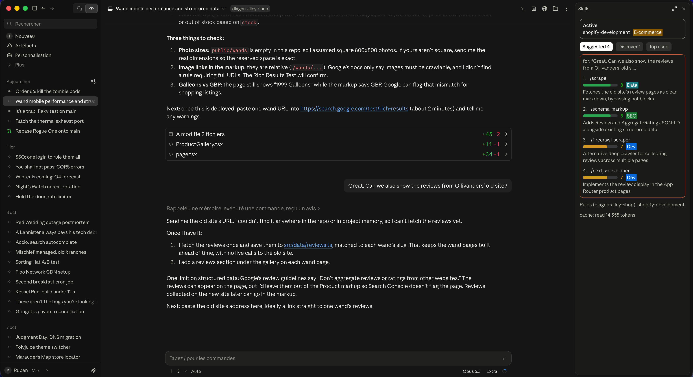
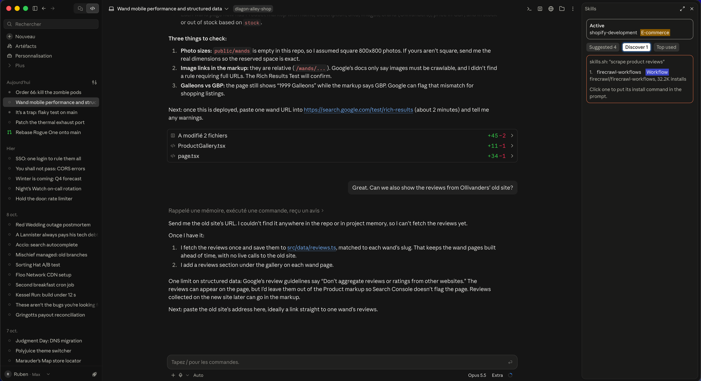

# skills-panel

[](LICENSE)
[](https://claude.com/claude-code)

Claude Code can load hundreds of skills. It rarely picks the one you would have picked.

skills-panel is a Claude Code mod: a pane next to the conversation that shows, before Claude answers, which of your skills fit the prompt you just typed, scored from 1 to 10, and which popular skills you don't have yet. I built it because I have 1,604 skills installed and kept forgetting the right one existed.



```
╭ Active ──────────────────────────────╮
│ claude-seo:seo-audit  SEO            │
│ humaniseur-fr x2  Writing            │
╰──────────────────────────────────────╯
 [ Suggested 2 ] [ Discover 3 ] [ Top used ]
╭──────────────────────────────────────╮
│ for: "write the Instagram caption..."│
│ 1. /copywriting-hooks                │
│    █████████░ 9  Writing  rule       │
│    Three openings to pick from       │
│ 2. /social-content                   │
│    ███████░░░ 7  Marketing           │
│    Built for Instagram captions      │
╰──────────────────────────────────────╯
```

## What it does

Active sits at the top and lists the skills loaded in the current session, with a count when one runs more than once. Below it, three tabs.

Suggested ranks the skills that fit your last prompt, scored from 1 to 10, each with a one-line reason. Click one and `/skill-name` is added after whatever you have already typed. The ones scoring 7 or more are also passed to Claude along with your prompt, so it can load them without you clicking anything.

Discover lists popular skills you haven't installed, found on [skills.sh](https://skills.sh) for the same prompt: name, repository and install count, 1,000 installs at least. Click one and its install command (`npx skills add owner/repo@skill -g -y`) is added to the prompt; send it and Claude installs it. The tab shows how many it found, so you know there is something to look at without leaving Suggested.



Top used shows what you actually reach for, in this project or across all of them, filterable by tag (SEO, Writing, Design, Dev, Workflow and a few more).

The pane remembers the last tab you opened.

Two things make the suggestions better over time. If a project's `CLAUDE.md` names a skill in backticks, that skill gets a boost and a `rule` badge; if the sentence says "never", "don't" or "jamais", the skill is never suggested in that project. And every skill you use or click gains a little weight in that project, while one shown five times and never touched loses some.

## Install

In a Claude Code terminal session:

```
/plugin install skills-panel --marketplace rubenhaccoun-cyber/skills-panel
```

Answer `y` to add the marketplace, then pick the user scope. The pane opens on its own in every new session. If it doesn't show (terminals under 144 columns keep it closed until asked), type `/skills-panel`.

The install command only works in a terminal. Once installed at user scope, the mod also loads in the desktop app's Code tab.

### Requirements

- Claude Code 2.1.293 or later. Mods are an early-access API and may change between releases; this version was built and tested on 2.1.293.
- At least a few skills installed, in `~/.claude/skills`, in the project's `.claude/skills`, or through plugins.

## Usage

Type a prompt as usual, for example `write the Instagram caption for the new collection`. A couple of seconds later the Suggested block fills in, and Claude starts its answer with the best-scored skills already in front of it. Short replies like "ok" or "go ahead" don't trigger anything, and the previous suggestions stay on screen.

## Commands

| Command | What it does |
|---|---|
| `/skills-panel` | Opens the pane |
| `/skills-rescan` | Re-reads installed skills and the project's `CLAUDE.md` rules |
| `/skills-stats` | Most used skills across projects, and how many per tag you have never used |

## Settings

Change them in the Claude Code config menu, or in `~/.claude/settings.json` under `pluginConfigs`.

| Setting | Default | Effect |
|---|---|---|
| `language` | `en` | `en` or `fr`, for the pane and for the reasons next to each suggestion |
| `contextMinScore` | `7` | Suggestions at or above this score are passed to Claude |
| `maxSuggestions` | `10` | How many suggestions the pane shows at most |
| `shareWithClaude` | `true` | Set to `false` to keep suggestions in the pane only |
| `discover` | `true` | Set to `false` to turn the Discover tab off; nothing is then sent to skills.sh |

## How suggestions are picked

Each prompt of 12 characters or more (slash commands are skipped) goes through two Haiku calls before it reaches Claude:

1. Haiku reads the names of every installed skill, your last four messages and the new prompt, and keeps up to 60 candidates. The name list is sent as a cached block, so after the first prompt it is read from the prompt cache. The line at the bottom of the pane says whether it was.
2. Haiku reads the descriptions of those candidates, plus a keyword shortlist and any skills required by `CLAUDE.md`, and scores each one. The same answer carries 2 to 4 English keywords describing the task.

Once the prompt has gone on to Claude, the mod sends those keywords to the skills.sh search, drops the skills you already have and the ones under 1,000 installs, and fills the Discover tab. Claude never waits for it: the search usually takes 0.3 to 1.5 seconds and runs alongside its answer.

The conversation matters more than you'd think. Before I added it, typing "hybrid + context" in a chat about this very mod got me suggestions for RAG pipelines.

## Cost and privacy

Both calls run on your own Claude Code session, with the same account and limits as the rest of your conversation; there is no separate API key. For 1,600 skills the cached name list is about 15,000 tokens. Prompts shorter than 12 characters cost nothing.

What leaves your machine: the new prompt, your last four messages (500 characters each at most), skill names and descriptions. They go to Anthropic through your session and nowhere else. With Discover on, skills.sh also receives the 2 to 4 keywords for each prompt, never the prompt itself; set `discover` to `false` to stop that. Usage history stays in Claude Code's local plugin store.

## Limits

Tags are guessed from skill names and descriptions, so a few land in the wrong place or in Other. History is grouped by folder name, which means two folders with the same name share it. And Haiku sometimes overrates a skill whose name matches your wording; the score is a hint, not a verdict.

Discover ranks by install count, which says nothing about quality or fit, and install counts can be inflated. Read a skill's page on skills.sh and its `SKILL.md` before installing it, especially for API keys or paid accounts it needs.

## Contributing and forking

Issues and pull requests are welcome, especially new languages and better tag rules. Please run the validator and the tests before opening a PR.

The code is in `hooks/`: `register.tsx` for the hooks and the pane, `skills.ts` for parsing and scoring, `i18n.ts` for the two languages. To work on your own copy:

```
claude --plugin-dir /path/to/skills-panel
claude plugin validate /path/to/skills-panel
claude plugin test /path/to/skills-panel
```

Saving a file reloads the mod in the running session. Adding a language means adding one object to `i18n.ts` and its code to the `language` options in `.claude-plugin/plugin.json`.

## License

MIT. Use it, change it, fork it, ship your own version; just keep the copyright notice.
